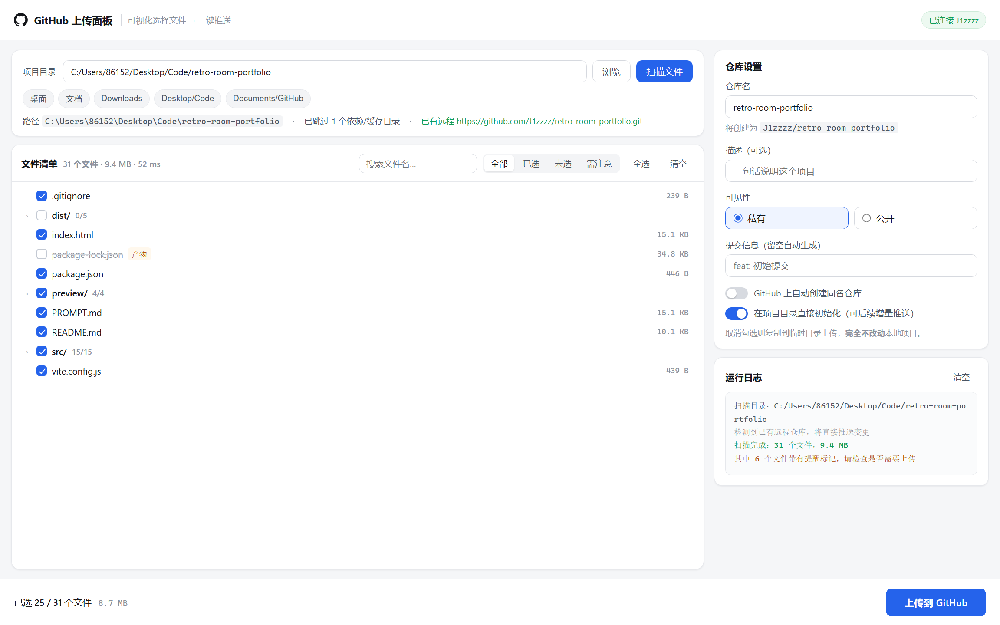

# GitHub 可视化上传面板

> 勾选文件 → 一键建仓 → 推送。把「本地项目上传到 GitHub」这件事从十分钟压缩到十秒。



一个跑在本机的轻量网页面板：选目录、用树形清单勾选要传的文件、填个仓库名，点「上传到 GitHub」就完事。不用记 git 命令，不用去网页点 New repository，也不用反复输密码。

- **零第三方依赖** — 只用 Node 内置模块，不需要 `npm install`
- **只监听 127.0.0.1** — 服务不对外网开放，Token 不离开本机
- **单文件服务 + 静态前端** — 整个项目 4 个文件，好读好改

---

## 它解决什么问题

手工传一个项目到 GitHub，通常要做这些事：

```bash
git init
# 想 .gitignore 该写啥
git add .
# 发现 node_modules 也被加进去了…
# 去网页 New repository，填名字、选公私
git remote add origin ...
git commit -m "..."
git push -u origin main
# 输入用户名密码 / PAT
# 网络卡住，重试
```

这个面板把上面整条链路收进一个界面，并且多做了三件手工容易出错的事：**挑文件**、**避开敏感文件**、**处理远程分叉**。

---

## 功能

| 能力 | 说明 |
|---|---|
| 树形勾选 | 按目录层级展示，支持目录级三态勾选（全选 / 部分 / 不选）、搜索过滤、只看已选 |
| 智能排除 | `node_modules`、`.git`、`__pycache__`、`venv`、`.next` 等体积目录**直接不扫描**，几千个依赖文件不会污染列表 |
| 敏感文件保护 | `.env`、`*.pem`、`*.key`、`id_rsa`、`credentials.json`、含 `secret` 的路径标红并**默认不勾选** |
| 产物识别 | `dist/`、`build/`、`*.min.js`、`package-lock.json` 等标橙，默认不勾选，需要时可手动勾上 |
| 大文件提示 | 单文件 ≥ 5 MB 标出体积，避免误传 |
| 精确提交 | 用 `git add --pathspec-from-file` 只暂存你勾选的文件，不会把未勾的内容带上去 |
| 一键建仓 | 填仓库名 → 自动 `gh repo create`（公有/私有可选）→ 关联 origin → 首次推送 |
| 增量推送 | 目录已是 git 仓库时，自动识别远程地址，切换成「推送到已有仓库」模式 |
| 分叉处理 | 远程有你没有的提交时，弹窗列出那些提交，让你选合并 / 变基 / 强制覆盖 |
| 冲突回滚 | 真冲突（两边改同一处）时自动 `merge --abort`，列出冲突文件，不留半完成状态 |
| 不动本地目录 | 关掉「在项目目录直接初始化」会把文件复制到临时目录上传，原目录一个字节都不改 |
| 后端轮询授权 | GitHub 设备码授权在后端完成，切浏览器授权也不会断链 |

---

## 快速开始

### 环境要求

| 依赖 | 版本 | 说明 |
|---|---|---|
| Windows | 10 / 11 | 启动脚本依赖 `cmd` 与 `winget` |
| Node.js | **22.15+**（推荐） | 低于此版本也能跑，但身处代理/加速环境时可能报证书错误 |
| Git | 任意较新版本 | 已装 Git for Windows 即可 |
| GitHub CLI (`gh`) | 2.x | 面板所有 GitHub 操作都通过它完成 |

> `start.bat` 会依次检查这三项，缺哪个就调 `winget` 自动装。装完自动继续，不用手动再点。

### 方式一：解压即用（推荐）

1. 解压压缩包到任意目录（路径别含中文以外的特殊字符，放桌面也行）
2. 双击 **`start.bat`**
3. 浏览器自动打开面板；首次使用点右上角「登录 GitHub」
4. 选「设备码授权」→ 生成验证码 → 在 `https://github.com/login/device` 输入并确认
5. 面板右上角变成「已连接 你的用户名」就绪

### 方式二：从仓库克隆

```bash
git clone https://github.com/J1zzzz/github-upload-panel.git
cd github-upload-panel
```

然后双击 `start.bat`，或命令行：

```bash
npm start        # 等同于 node server.js --open
```

---

## 使用流程

1. **选目录** — 填项目路径，或点「浏览」选文件夹（建议复制完整路径粘贴进去）
2. **扫描** — 自动列出全部文件并分类；顶部会显示「路径 / 跳过 N 个依赖目录 / 是否已是 git 仓库」
3. **勾选** — 默认已按规则勾好，你只需检查标红/标橙的项；支持按目录整块勾选
4. **填仓库名** — 右侧「仓库设置」里填名字、描述、公有或私有
5. **上传** — 底部按钮；右侧日志会实时显示 `git init → add → commit → push` 每一步

想推到**已有仓库**时：目录里已有 `.git` 且配了 `origin`，面板会自动进入推送模式，「创建新仓库」开关会自动关掉，你只需勾选变更的文件。

---

## 遇到分叉怎么办

上传时如果远程有本地没有的提交，面板不会甩英文报错，而是弹窗：

```
远程分支 main 有 1 个本地没有的提交，同时你本地有 1 个待推送的提交
────────────────────────────────────────
97eec28   remote: 别人改的       J1zzzz · 25 秒前
────────────────────────────────────────
      [强制覆盖远程]  [变基]  [合并]
```

| 选择 | 实际执行 | 结果 | 什么时候用 |
|---|---|---|---|
| **合并** | `git pull --no-rebase --allow-unrelated-histories` | 生成 merge commit，双方历史都保留 | 多人协作，最稳妥 |
| **变基** | `git pull --rebase` | 你的提交重放到远程之上，历史是一条直线 | 个人项目，喜欢干净历史 |
| **强制覆盖** | `git push --force-with-lease` | 远程被本地覆盖，**远程独有提交会丢失** | 确认远程内容不要了 |

如果两边改了**同一处代码**，任何策略都无法自动决定用谁，此时面板会：

- 中止操作并 `git merge --abort`，恢复到上传前的状态（不留 `MERGE_HEAD`）
- 列出冲突文件路径
- 你手动解决后重新点上传即可

---

## 常见问题

**Q：报错 `fetch failed` 或 `UNABLE_TO_VERIFY_LEAF_SIGNATURE`？**

这是证书问题，通常由 FastGithub、公司代理这类“把 GitHub 域名劫持到本地反代并签发自有证书”的工具引起。Node 默认只信内置 CA，不认这类证书。

面板已内置处理：启动时自动用 `--use-system-ca` 让 Node 走 Windows 证书库。如果仍然失败，说明 Node 版本低于 22.15（不支持该参数），升级 Node 即可。

**Q：端口 7717 被占用？**

服务会自动向上找空端口（最多试 12 个），并把实际端口写进 `.port` 文件，控制台也会打印真实地址。

**Q：提示「GitHub 上已存在同名仓库」？**

换个仓库名，或关掉「在项目目录直接初始化 / 自动创建仓库」，改为填已有远程地址。

**Q：会不会把我的 `.env` 传上去？**

不会。`.env` 系列、私钥、`credentials.json` 默认**不勾选**，且标红提醒。但请注意：**勾选状态由你最终决定** —— 面板是助手，不是保险柜，传之前扫一眼红色项。

**Q：会上传 `.git` 目录或历史吗？**

不会扫描 `.git`。上传的只是你勾选的当前文件内容。

**Q：能不能不用面板、直接命令行？**

可以，面板本质就是 `git` + `gh` 的封装。命令都在右侧日志里完整可见，可复制出来复用。

**Q：Mac / Linux 能用吗？**

服务端逻辑是跨平台的，但 `start.bat`、`gh` 路径探测、浏览器自动打开都按 Windows 写的。在 Mac/Linux 上手动 `node server.js` 大概率可用，但未做适配与测试。

---

## 安全说明

- 服务只绑定 `127.0.0.1`，局域网内其它机器访问不到
- 不在本项目内保存任何 Token：认证结果直接写入 `gh` 自己的配置（`~/.config/gh/hosts.yml`）
- `config.json` 只记录「上次用哪种方式登录」这类无敏感信息，可随时删除
- 面板不收集、不上报任何数据，没有第三方请求

---

## 目录结构

```
github-upload-panel/
├── server.js            # 本地服务：扫描、分类、git/gh 调用、SSE 日志流
├── public/
│   ├── index.html       # 界面结构
│   ├── style.css        # 样式
│   └── app.js           # 前端逻辑：文件树三态勾选、日志渲染、冲突弹窗
├── start.bat            # 一键启动（含依赖检测与自动安装）
├── package.json
├── README.md
├── 使用说明.md           # 更详细的图文操作手册
└── docs/
    └── screenshot.png
```

---

## 开发

```bash
node server.js            # 启动，不自动开浏览器
node server.js --open     # 启动并打开浏览器
PORT=8080 node server.js  # 指定端口
```

主要接口（全部本地）：

| 接口 | 作用 |
|---|---|
| `GET /api/env` | 检测 git / gh / 登录状态 |
| `GET /api/home` | 返回常用目录快捷入口 |
| `POST /api/scan` | 扫描目录，返回文件清单与分类标记 |
| `POST /api/upload` | 执行上传，SSE 流式返回日志与冲突事件 |
| `POST /api/auth/device/start` | 发起 GitHub 设备码授权 |
| `POST /api/auth/token` | 用 PAT 登录 |

---

## License

[MIT](LICENSE)
